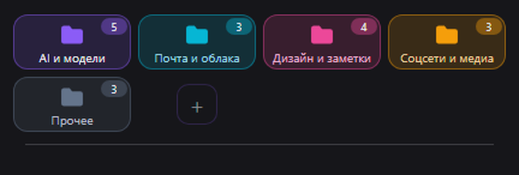
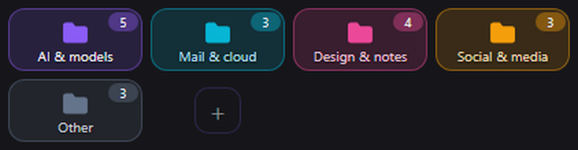
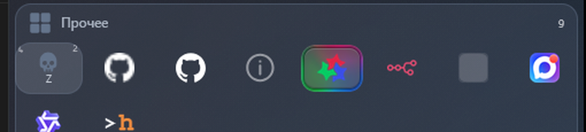
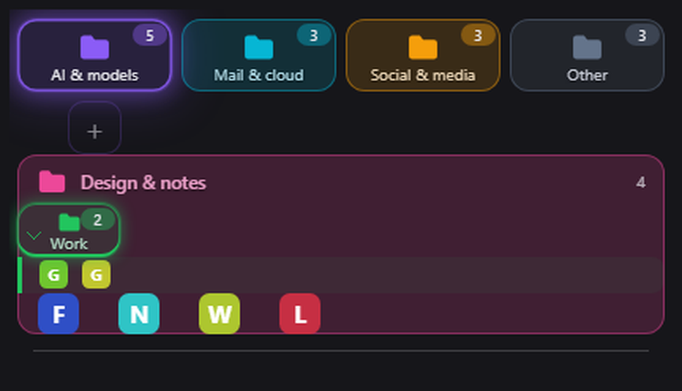
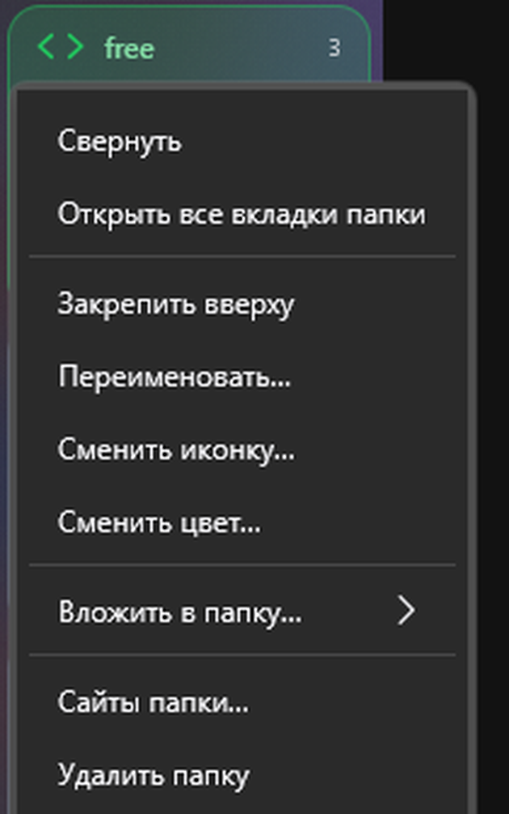
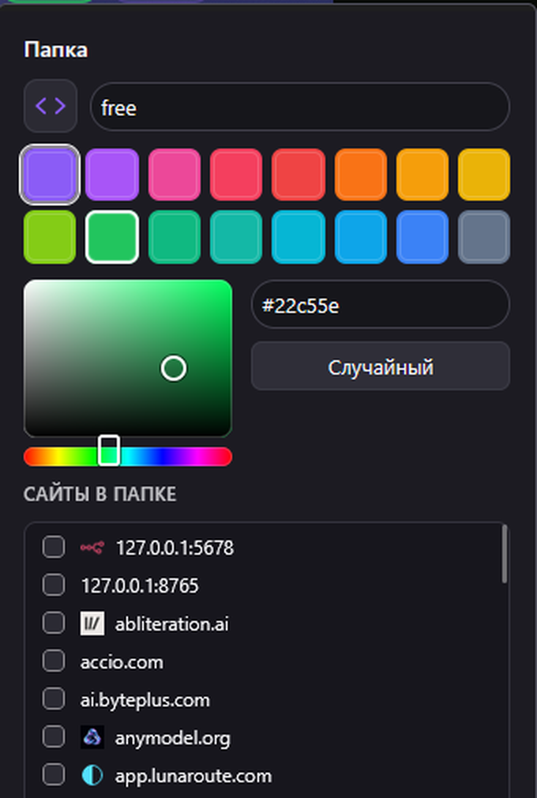
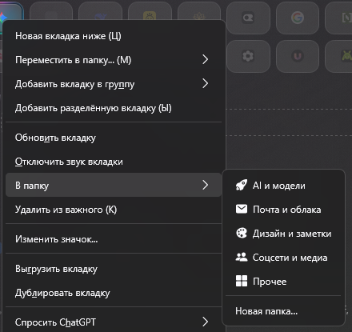
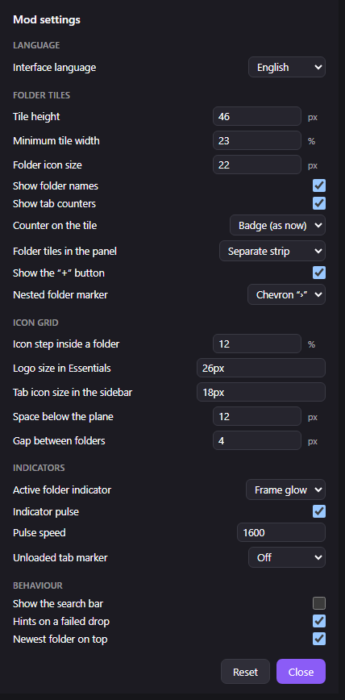
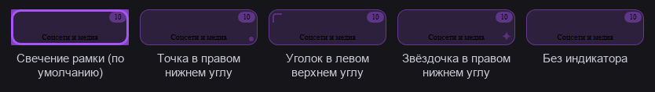

# Essentials Folders — folder tiles for the Zen Browser Essentials grid

[](https://github.com/danonchek51/zen-essentials-folders/releases)
[](LICENSE)
[](https://zen-browser.app)
[](https://github.com/sineorg/store)

**Essentials Folders** is a [Zen Browser](https://zen-browser.app) mod that turns the
**Essentials** grid (the pinboard) into **folder tiles**. Folders nest inside each other to any
depth, tabs and folders are rearranged by drag & drop, there is a search box for folders, and the
mod ships its own settings dialog with 21 options. Your tabs stay ordinary Zen tabs — the mod
never moves or deletes anything.

| What is inside | Value |
|---|---|
| Configurable options | 21, in four groups |
| Active-folder indicator styles | 4, plus off |
| Folder nesting depth | unlimited |
| Membership rules | domain, domain + path, exclusion |
| Compatibility | Zen Tab Groups (oom333) |
| License | [MIT](LICENSE) |

[Русская версия](README.md) · [Change log](CHANGELOG.md) · [Releases](https://github.com/danonchek51/zen-essentials-folders/releases)



## What it does

- **Folder tiles in the Essentials grid** — icon, name, colour and a tab counter on each tile.
  Click a tile to expand it, right-click to manage it.
- **An open folder is a colour plane.** The tile leaves the top row and unfolds into a wide
  coloured plane that holds its own tiles. Nothing is duplicated: the row keeps only collapsed
  folders.
- **The newest folder goes on top.** The folder you opened last sits above the other open ones.
- **Nested folders.** Drag a folder tile onto another one and it nests inside it. The depth is
  not limited. Nested folders are marked with a `›` chevron.
- **Rearranging.** Drag a tile by its edge and the two folders swap places. Drag an icon next to
  another icon and it lands before or after it, depending on which half you dropped it on.
- **Only the dragged tab moves.** Drop one GitHub tab into another folder and only that tab
  goes; the other GitHub tabs stay put (see [How membership works](#how-membership-works)).
- **Dropping into an open folder.** Drop a tile onto the coloured area of an open folder and it
  moves into that folder.
- **Dragging a tab from the sidebar** works too — the mod reads the tab straight from the drag
  buffer instead of relying on the drag-start event.
- **A separator** below the folders holds the pinned tabs that are in no folder. Drop an icon
  there to pull it out of its folder while keeping it pinned.
- **Right-click menu** on a tile: expand/collapse, open all tabs, pin to top, rename, change
  icon, change colour, nest into another folder, move to the top level, list sites, delete,
  expand/collapse all.
- **A `+` tile** at the end of the row creates a new folder straight from the panel.
- **Search for folders** — the box above the tiles filters by folder name or domain.
  `Esc` or the cross resets it.
- **A pinned folder** always stays in the top row, marked with a dot in the corner.
- **The panel no longer covers your tabs.** The folder panel is height-limited and scrolls on
  its own; the regular Zen tab list stays below it.
- **Any colour for a folder.** Besides 16 preset shades, the dialog has a colour picker, a
  hex field (`#rrggbb`) and a random button.
- **Bigger, brighter logos** in the Essentials grid: 26 px instead of 16 px, without the Firefox
  or Zia dimming, and every logo gets the same cell so they line up.
- **The active folder is marked.** The folder that holds the current tab is highlighted — by
  default with a pulsing frame, or with a dot, a corner or a star. See
  [Active folder indicator](#active-folder-indicator).
- **Its own settings dialog** — 21 options in four groups: folder tiles, icon grid, indicators
  and behaviour. Everything applies immediately, with no Save button.

## Screenshots

Real screenshots from Zen Browser 1.24b.

| Tile row | Open folder | Nested folder | Tile menu | Folder dialog | "Move to folder" |
|---|---|---|---|---|---|
|  |  |  |  |  |  |

## Settings

The mod has **its own settings dialog** — open it with the `⚙` gear to the right of the search
row, or with `Mod settings…` in the folder menu.



21 options in four groups:

| Group | What it controls |
|---|---|
| **Folder tiles** | tile height, minimum width, folder icon size, whether names and counters are shown, counter style (badge / dot / off), nesting chevron (on / off) |
| **Icon grid** | icon step inside a folder, logo size in Essentials, sidebar tab icon size, padding under a plane and the gap between blocks, tile row (strip / grid) |
| **Indicators** | active-folder style (glow / dot / corner / star), pulsing on/off and its speed, unloaded-tab marker (frame / dashed / dot / line / dimmed / off) |
| **Behaviour** | search row, `+` button, hints for a failed drop, newest folder always on top |

Values apply **immediately** — there is nothing to save. The `Reset` button restores the
defaults.

The five original settings (`show-names`, `show-count`, `show-search`, `icon-size`,
`tab-icon-size`) still work: the mod reads an old value if you had one and keeps the new one
next to it, all in a single `zen.essentialsfolders.settings` pref.

## Active folder indicator

The mod marks the folder that holds the **current tab**. By default that is a pulsing frame:
the frame itself is always visible and only the halo around it pulses, so the indicator reads
on any folder colour and in any theme.



| Style | What it looks like |
|---|---|
| **Glow** (default) | A frame in the folder colour with a pulsing halo |
| **Dot** | A small dot in the bottom-right corner of the tile |
| **Corner** | A corner mark in the top-left corner of the tile |
| **Star** | A star in the bottom-right corner of the tile |

Pulsing can be switched off — both by a mod setting and by the system
`prefers-reduced-motion` setting (if "reduce motion" is on in your OS, the pulsing stops
by itself).

## Drag & drop

| Where you dropped it | What happened |
|---|---|
| On a folder tile (anywhere) | A site tile moves into that folder; a folder tile nests into it |
| On the edge of a folder tile (folders only) | The two folders swap places |
| On the coloured area of an open folder | A site tile moves into that folder; a folder tile nests into it |
| On an icon inside a folder | The tile lands before or after that icon (left/right half) |
| On the separator below the folders | A site tile leaves its folder; a folder tile moves to the top level |

While you drag, Zen inserts an empty slot into the Essentials grid, which shifts the tiles and
makes a drop land in the wrong place. The mod remembers the tile layout at drag start and
resolves the target against it, so the tab lands where you aimed even if the grid moved.

## How membership works

A folder stores **rules**, not tabs. A plain rule is a domain: `github.com` means "every GitHub
tab in this folder". But when you drag a tab from one folder to another, the mod remembers it
more precisely, by full URL:

| Rule | What lands in the folder |
|---|---|
| `github.com` | every GitHub tab |
| `github.com/owner/repo` | that repository and its inner pages |
| `github.com/` | only the GitHub home page |
| `!github.com/owner/repo` | nothing: that tab is excluded from the folder |

So when you drag one `github.com/owner/repo` tile from "GitHub" into "Work":

- "Work" gets the rule `github.com/owner/repo` and holds only that tab;
- "GitHub" keeps the rule `github.com` and gains the exclusion `!github.com/owner/repo` — the
  other GitHub tabs stay where they were.

A URL with no path (`https://github.com/`) becomes the rule `github.com/` — the home page only.

To add a whole site, right-click a tab → `Move to folder`: a plain domain rule is added and all
tabs of that site join the folder. In the folder dialog you can tick the domain yourself.

## Install (Install)

The mod installs in a minute: ready-made files, no build step and no npm. Zen reads the mod at
startup, so restart Zen after installing.

### Quick start

`Sine Mods` → `Install from repo` → paste the link → restart Zen:

```
https://github.com/danonchek51/zen-essentials-folders
```

### Option 1. Through Sine (recommended)

Sine is the mod manager built into Zen (Settings → Sine Mods).

1. Open `Settings` → `Sine Mods` → `Marketplace` in Zen.
2. Find **Essentials Folders** and press `Install`.
3. Restart Zen.

Sine pulls new versions from the repository on its own — there is nothing to update manually.

### Option 2. Manually (no mod manager)

1. Close Zen.
2. Copy `theme.json`, `preferences.json`, `chrome.css` and `essentials-folders.uc.js` into

   ```
   <Zen profile>\chrome\sine-mods\zen-essentials-folders\
   ```

   The profile usually lives here:
   `%APPDATA%\zen\Profiles\<profile-name>\`

3. Add an entry to `chrome\sine-mods\mods.json` (if it is not there yet):

   ```json
   "zen-essentials-folders": {
     "id": "zen-essentials-folders",
     "name": "Essentials Folders",
     "description": "Folder tiles for the Essentials panel.",
     "style": {"chrome": "chrome.css", "content": ""},
     "scripts": {
       "essentials-folders.uc.js": {"include": ["chrome://browser/content/browser.xhtml"]}
     },
     "preferences": "preferences.json",
     "enabled": true
   }
   ```

4. Start Zen.

Quick option: run `python install.py` from the mod folder — the script finds the Zen profile,
copies the files and fixes `mods.json` for you.

> **Close Zen before editing `mods.json` and `prefs.js`.** Zen rewrites those files on exit and
> can overwrite your changes.

## How to use

1. Out of the box the mod creates five folders for your current Essentials: "AI and models",
   "Mail and cloud", "Design and notes", "Social and media", "Other". Rename, delete them and
   make your own if your sets are different.
2. Click a tile to open the folder. It unfolds into a coloured plane with its tiles inside.
   Click the folder header to collapse it. Several folders can be open at once, the newest on
   top.
3. Pinned tabs that are in no folder sit at the very bottom, behind the separator.
4. To move a tab into another folder: right-click its icon → `Move to folder` → pick a folder
   (the **whole site** moves). Or drag the icon onto a folder tile or onto the coloured area of
   an open folder — then **only that tab** moves and becomes pinned in Essentials.
5. To take a tab out of a folder, drag its icon onto the separator line below the folders. The
   tab stays pinned in Essentials but leaves the folder.
6. Right-click a tile → `Delete folder` to remove it. Nested folders are not lost — they move
   up one level.
7. There is a **search row** above the tiles: type a folder name or a domain and only the
   matches stay. `Esc` clears it.
8. For a folder you use often: right-click → `Pin to top`. Such a folder always sits in the top
   row.
9. The folder panel is height-limited: with many open folders it scrolls on its own (mouse
   wheel over the tiles). At the edge of the panel the wheel scrolls the regular tab list. The
   Zen tab list and tab groups stay below the panel and are always reachable.
10. Custom folder colour: right-click a tile → `Change colour…`. Pick a shade with the picker,
    type a hex code (`#e11d48`) or press `Random`, then `Save` — the colour changes at once.
    If the `Save` button is off-screen (the domain list is long), press `Ctrl+Enter`; it is the
    same `Save`.

### Where folders are stored

The data lives in the Zen preferences, so it survives restarts and browser updates:

- `zen.essentialsfolders.folders` — folders: name, colour, icon, parent (`parentId`), domains
  (`sites`) and their order, plus the `pinned` flag
- `zen.essentialsfolders.collapsed` — which folders are collapsed
- `zen.essentialsfolders.order` — the order of open folders, newest first
- `zen.essentialsfolders.settings` — the mod settings (one JSON): tile look, icon grid,
  indicators and behaviour

A tab belongs to a folder **by an address rule**, not by tab id: a browser restart, a page
redirect and a tab move never break it.

## FAQ

### What is Essentials Folders?

Essentials Folders is a Zen Browser mod that turns the Essentials grid into folder tiles.
Folders nest inside each other, tabs and folders are rearranged by drag & drop, and the mod has
its own settings dialog with 21 options.

### Do I have to move my tabs into folders by hand?

No. The mod never moves or deletes anything: tabs stay ordinary Zen tabs with their bookmarks
and history. Tabs join a folder by an address rule — for example every `github.com` tab, or
one specific page.

### Where does the mod save my folders?

In the Zen preferences, so they survive restarts and browser updates: the
`zen.essentialsfolders.folders`, `.collapsed`, `.order` and `.settings` prefs.

### Will the mod keep working after Zen updates?

Yes. It uses public Zen APIs (`gZenWorkspaces.getCurrentEssentialsContainer()`) and the
`.zen-essentials-container` CSS class, and the DOM observer reconnects itself when the
workspaces or tabs change.

### Does it work with other mods?

Yes. It does not touch tabs or their data, it only draws tiles. Confirmed compatibility:
**Zen Tab Groups** (oom333).

### Do I have to configure anything?

No, it works out of the box. If you want to: the `⚙` gear to the right of the search row (or
`Mod settings…` in the folder menu) opens 21 options in four groups. Values apply immediately.

### How do I undo the install?

Delete the `chrome\sine-mods\zen-essentials-folders` folder and its entry in `mods.json`, then
restart Zen. No tab is lost.

### The tiles are gone — what now?

Open `about:support` → "Profile Folder" and check that
`chrome\sine-mods\zen-essentials-folders\essentials-folders.uc.js` is there. Reloading Zen with
`Ctrl+Shift+R` often helps.

## Why the mod is safe

- The mod **never moves and never deletes** anything: tabs remain ordinary Zen tabs, so Ctrl+W
  (unload), clicking the icon to reload and tab drag & drop keep working as usual.
- The mod **only draws**: it adds its own tiles to the Essentials grid, hides the contents of a
  collapsed folder and sets the display order through CSS `order`.
- No tab is ever replaced: at worst the tiles do not appear, but your tabs and their data stay
  where they are.
- Hiding a collapsed folder uses a CSS attribute, not inline styles.
- Only the **logos in the Essentials grid** and the tile background change: the opacity of icons
  in the regular tab list, on tabs and elsewhere in the UI is untouched.
- Zen's Essentials counter keeps counting real tabs only.
- The mod survives Zen updates: it uses public APIs
  (`gZenWorkspaces.getCurrentEssentialsContainer()`) and the `.zen-essentials-container` CSS
  class, and the DOM observer reconnects itself.

## Troubleshooting

- **The tiles are gone.** Open `about:support` → "Profile Folder" and check that
  `chrome\sine-mods\zen-essentials-folders\essentials-folders.uc.js` is in place. A simple Zen
  reload helps: `Ctrl+Shift+R`.
- **The menu does not work.** Check that the mod is enabled in Zen Mods.
- **Undo.** Delete the `chrome\sine-mods\zen-essentials-folders` folder and its entry in
  `mods.json`, then restart Zen. No tab is lost.
- Messages from the mod appear in `about:support` → "Browser Console", marked with the `[ZEF]`
  prefix.

## Compatibility

The mod plays well with others: it touches neither tabs nor their data, it only draws its tiles
in the Essentials grid. In particular it works together with the **Zen Tab Groups** mod
(oom333) — tab groups in the sidebar.

## Contributing

- **Report a bug** — [Issues](https://github.com/danonchek51/zen-essentials-folders/issues):
  Zen version, mod version, steps to reproduce.
- **Suggest an idea** — [Discussions](https://github.com/danonchek51/zen-essentials-folders/discussions).
- **Send a patch** — [CONTRIBUTING.md](CONTRIBUTING.md): how to install the mod locally, how to
  verify a change and how to open a pull request.
- **Translate** — the English version is this file; other languages are welcome.

## License

MIT — see [LICENSE](LICENSE).

## Author

**Essentials Folders** is a mod for [Zen Browser](https://zen-browser.app) by
[@danonchek51](https://github.com/danonchek51).

Questions and suggestions: [Issues](https://github.com/danonchek51/zen-essentials-folders/issues)
and [Discussions](https://github.com/danonchek51/zen-essentials-folders/discussions).
