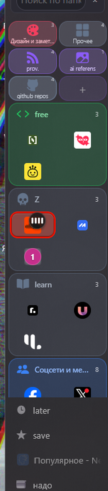
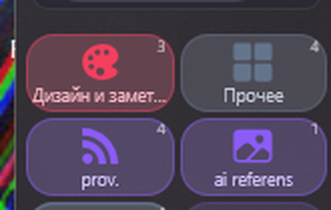
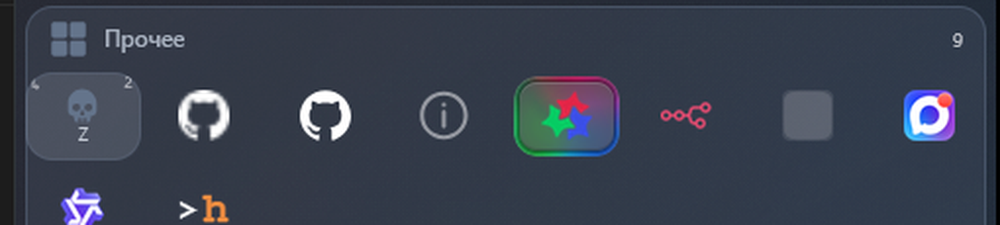
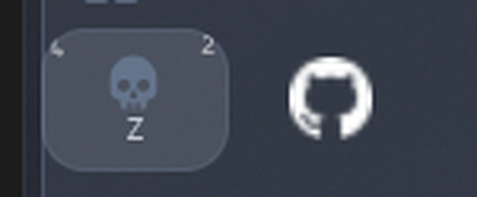
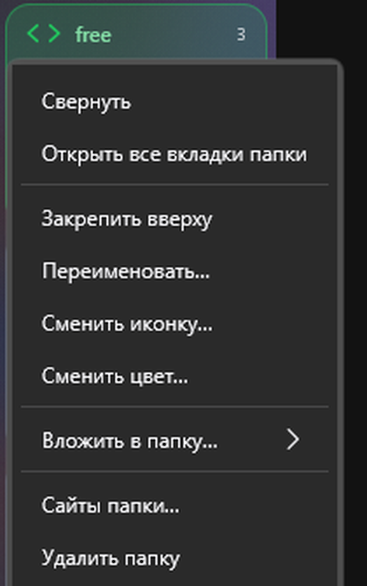
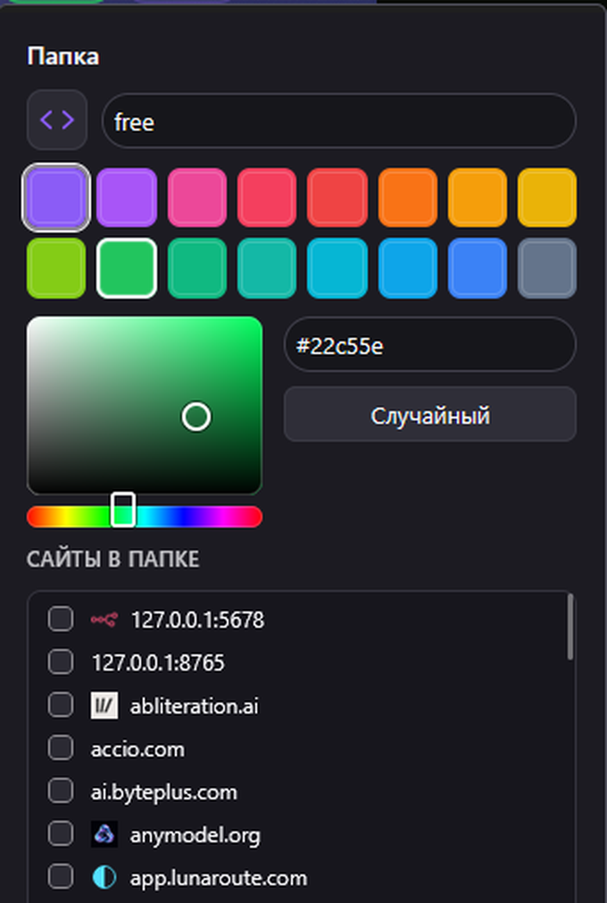
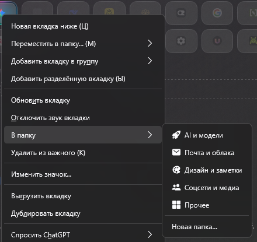
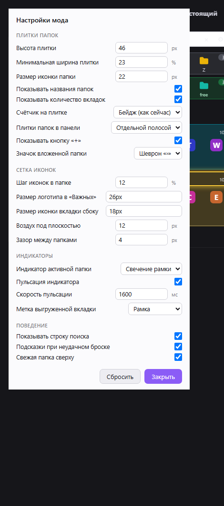
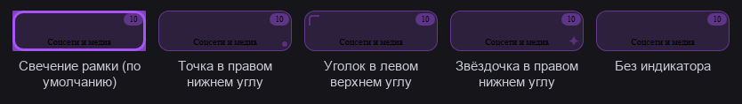

# Essentials Folders — плитки-папки для «Важных» в Zen Browser

Мод превращает «Важные» (Essentials) в набор **плиток-папок**: вместо россыпи иконок в панели
слева появляются цветные плитки с иконкой, названием и счётчиком вкладок. Клик по плитке —
развернуть или свернуть папку, правый клик — управление.

Открытая папка **вытекает в широкую плоскость своего цвета**, и её плитки лежат внутри этой
плоскости. Отдельной «шапки» и дублирующей плитки больше нет: папка показана ровно один раз.
Несколько папок можно держать открытыми одновременно — самая свежая (та, что открыли последней)
стоит выше остальных.

Папки можно **вкладывать друг в друга** (на любую глубину), **менять местами** и **переставлять
плитки внутри** — всё обычным перетаскиванием мышью.



## Что умеет

- **Плитки-папки** в сетке «Важных»: иконка, название, цвет, счётчик вкладок.
- **Открытая папка — плоскость цвета.** Клик по плитке: плитка уходит из верхнего ряда
  и разворачивается широкой цветной плоскостью, внутри которой стоят её плитки.
  Никакого дублирования: в ряду остаются только свёрнутые папки.
- **Свежая папка — сверху.** Та папка, которую открыли последней, стоит выше остальных открытых.
- **Вложенные папки.** Перетащите плитку папки на плитку другой — она вложится внутрь
  (вложенная папка помечена шевроном «›» слева от иконки). Глубина вложенности не ограничена.
- **Перестановка папок.** Перетащите плитку за край — папка встанет рядом с той, на которую
  бросили. Вложенную папку так же можно вытащить обратно наверх.
- **Перестановка плиток внутри папки.** Перетащите иконку на соседнюю иконку — плитка
  встанет перед ней или после неё, в зависимости от того, с какой стороны вы отпустили.
- **Переносится только та вкладка, которую тянули.** Бросили иконку GitHub с одним
  репозиторием в другую папку — переехала только она, остальные вкладки GitHub остались
  на месте (см. «Как это работает»).
- **Зона приёма — сама открытая папка.** Бросьте плитку в цветную область открытой папки —
  она переедет в эту папку (из прежней папки при этом уйдёт).
- **Перетаскивание вкладки в папку.** Бросьте вкладку (из «Важных» или из обычной панели)
  на плитку или на область открытой папки — вкладка закрепится в «Важных» и окажется в папке.
- **Разделитель** отделяет плитки папок от закреплённых вкладок, которые не вошли ни в одну
  папку: бросьте туда иконку — вкладка выйдет из папки, но останется закреплённой.
- **Правый клик по плитке** — меню: развернуть/свернуть, открыть все вкладки папки,
  закрепить вверху, переименовать, сменить иконку, сменить цвет, вложить в другую папку,
  вынести на верхний уровень, список сайтов, удалить, развернуть/свернуть все папки.
  То же меню открывается и по правому клику на **шапку открытой папки** — то есть
  открытую папку тоже можно переименовать, перекрасить или открепить.
- **Плитка «+»** в ряду — создать новую папку прямо из панели.
- **Поиск по папкам**: строка над плитками. Печатаете название папки или домен —
  и остаются только совпадения. `Esc` или крестик — сбросить поиск.
- **Закреплённая папка** (пинка в меню папки) всегда стоит в верхнем ряду, над всеми
  остальными, и отмечена точкой в углу плитки. У открытой папки точка видна на шапке.
- **Панель не закрывает вкладки.** Развернутые папки больше не занимают всю левую
  панель: панель ограничена по высоте и прокручивается сама, а под ней остаётся
  обычный список вкладок Zen (и группы вкладок) — как в браузере без мода.
- **Открыть все вкладки папки** — вкладки папки выделяются сразу и открываются рядом.
- **Диалог папки**: имя, цвет, иконка (штатный пикер Zen), список доменов с галочками,
  добавление домена вручную.
- **Цвет папки — любой.** Кроме 16 предустановленных оттенков в диалоге есть пипетка
  (квадрат оттенка + полоса цвета), поле для точного кода (`#rrggbb`, понимает и `#rgb`)
  и кнопка «Случайный». Выбранный цвет сразу виден на плитке папки и на её шапке.
- **Пункт «В папку»** в меню вкладки «Важных»: положить вкладку в существующую папку
  или сразу создать новую с этим доменом.
- **Яркие крупные логотипы** в сетке «Важных»: 26 px вместо 16 px, без приглушения
  Firefox и Zia. Иконки плоские, без тёмных подложек.
- **Все логотипы одного размера.** Раньше мелкие favicon рисовались в натуральную
  величину, и в папке они разъезжались по размеру. Теперь у каждого логотипа своя
  одинаковая ячейка, а картинка вписывается в неё целиком.
- **Плитки папок — отдельной полосой.** Они лежат в ряд на всю ширину панели и делят
  эту ширину поровну: расширил сайдбар — плитки стали шире, а не добавилась ещё одна
  в ряд. Раньше размер плитки не зависел от ширины панели совсем.
- **Название плитки не режется.** У всех плиток одинаковая высота, длинное название
  укорачивается многоточием, но не обрезается по вертикали.
- **Счётчик — аккуратный бейдж** в углу плитки, а не голое число поверх иконки.
- **Плитка «+» — отдельная кнопка** в конце ряда, а не ещё одна карточка: её не
  спутаешь с папкой.
- **Перетаскивание работает и с вкладками из сайдбара.** Если перетаскивание
  началось там, мод берёт вкладку прямо из буфера перетаскивания, а не ищет её
  по событию старта. Раньше бросок выглядел как «сюда нельзя».
- **Подсказка вместо молчания.** Если бросок не сработал, мод объясняет почему:
  например, «вкладка уже в этой папке».
- **Логотипы не пропадают.** Значок сайта может приехать позже, чем панель
  перестроилась: мод перепроверяет иконки ещё дважды после этого, и слушает
  загрузку и ошибку — надпись «ярлык» больше не заменяет логотип навсегда.
- **Ровная сетка внутри папки.** Иконки папки стоят в колонках одинаковой ширины
  с одинаковым шагом — на цветной плоскости видно, где какая вкладка.
- **Колонки тянутся на всю ширину панели.** Колонки не копятся в углу, а поровну
  делят доступное место: шапка папки и её иконки всегда выровнены по одной линии,
  а размер панели на это не влияет.
- **Воздух вокруг иконок.** Внутри цветной плоскости вокруг каждого логотипа
  одинаковые поля (10 px с каждой стороны) — иконки не прилипают ни к краю,
  ни друг к другу.
- **Плоскость — ровно по содержимому.** Цветная область заканчивается сразу под
  последней иконкой папки: пустого места снизу не остаётся.
- **Вложенная папка — отдельным рядом.** Когда папку открыли внутри другой папки,
  её иконки стоят в своём ряду, а иконки родительской папки начинаются со следующего
  ряда (между рядами — 12 px). Раньше они продолжали один ряд, и цветная плоскость
  вложенной папки накрывала иконки родителя — они выглядели как содержимое вложенной
  папки, а счётчик показывал «4», хотя в плоскости лежало больше плиток.
- **Между открытыми папками — зазор.** Цветные области соседних открытых папок
  больше не наезжают друг на друга и не закрывают шапку следующей папки: между
  ними остаётся видимый зазор. Раньше плоскость каждой папки доходила до
  следующей на 12 px и закрывала её заголовок.
- **Видно, какая вкладка выгружена из памяти.** У выгруженной вкладки вокруг
  логотипа появляется рамка: сразу видно, какая вкладка «спит», а какая в памяти.
- **Если у сайта нет логотипа**, вместо пустого серого квадрата показывается первая буква
  адреса на цветном круге — цвет у каждого сайта свой и всегда одинаковый.
- **Видно, какая папка активна.** Та папка, в которой лежит текущая вкладка, помечена:
  по умолчанию — пульсирующим свечением рамки. Стиль выбирается в настройках мода:
  свечение рамки, точка, уголок или звёздочка в углу плитки.
- **Свои настройки в одном месте.** В моде появился свой диалог «Настройки мода»:
  21 параметр в четырёх группах — вид плиток, сетка иконок, индикаторы и поведение.
  Всё применяется сразу, без кнопки «Сохранить».

| Ряд плиток | Открытая папка | Вложенная папка | Меню плитки | Диалог папки | «В папку» в меню вкладки |
|---|---|---|---|---|---|
|  |  |  |  |  |  |

## Настройки мода

В моде есть **свой диалог настроек** — открывается шестерёнкой `⚙` справа от строки
поиска или пунктом `Настройки мода…` в меню папки.



Всего 21 параметр в четырёх группах:

| Группа | Что настраивается |
|---|---|
| **Плитки папок** | высота плитки, минимальная ширина, размер иконки папки, показывать ли названия и счётчик, вид счётчика (бейдж / точка / без), значок вложенности (шеврон / без) |
| **Сетка иконок** | шаг иконок внутри папки, размер логотипа в «Важных», размер иконки вкладки сбоку, воздух под плоскостью и зазор между блоками, ряд плиток (полоса / сетка) |
| **Индикаторы** | стиль активной папки (свечение / точка / уголок / звёздочка), пульсация вкл/выкл и её скорость, вид метки у выгруженной вкладки (рамка / пунктир / точка / линия / приглушение / без) |
| **Поведение** | строка поиска, кнопка «+», подсказки при неудачном броске, свежая открытая папка всегда сверху |

Значения применяются **сразу** — ничего нажимать не нужно. Кнопка `Сбросить`
возвращает всё к значениям по умолчанию.

Пять старых настроек (`show-names`, `show-count`, `show-search`, `icon-size`,
`tab-icon-size`) по-прежнему работают: если вы меняли их раньше, мод подхватит
старое значение, а новое сохранит рядом — в одном настройке
`zen.essentialsfolders.settings`.

## Индикатор активной папки

Мод помечает папку, в которой лежит **текущая вкладка**. По умолчанию это
пульсирующее свечение рамки: рамка видна всегда, а ореол вокруг неё мягко
пульсирует — папка сразу видна и в светлой, и в тёмной теме, при любом цвете
папки.



| Стиль | Как выглядит |
|---|---|
| **Свечение рамки** (по умолчанию) | Рамка цвета папки и пульсирующий ореол вокруг неё |
| **Точка** | Маленькая точка в правом нижнем углу плитки |
| **Уголок** | Уголок в левом верхнем углу плитки |
| **Звёздочка** | Звёздочка в правом нижнем углу плитки |

Пульсацию можно выключить — и настройкой мода, и системной настройкой
`prefers-reduced-motion` (если в системе включено «уменьшить движение»,
пульсация отключается сама).

## Как перетаскивать

| Куда бросили | Что получилось |
|---|---|
| На плитку папки (в любую точку) | Плитка сайта переезжает в эту папку; плитка папки — вкладывается в неё |
| На край плитки папки (только для папок) | Папка встаёт рядом с той, на которую бросили (обмен местами) |
| На цветную область открытой папки | Плитка сайта переезжает в эту папку; плитка папки — вкладывается в неё |
| На иконку внутри папки | Плитка встаёт перед этой иконкой или после неё (левая/правая половина) |
| На разделитель под папками | Плитка сайта выходит из папки; плитка папки — выходит на верхний уровень |

### Бросок попадает в цель с первого раза

Пока тянете плитку, Zen вставляет в сетку «Важных» пустое место под вкладку — из-за этого
плитки съезжают, и бросок попадает в это место, а не в папку. Мод запоминает раскладку плиток
в начале перетаскивания и определяет цель по ней: даже если сетка сдвинулась, вкладка
приземлится туда, куда вы целились. Если рядом с курсором нет ни одной плитки, мод не
мешает Zen — бросок останется обычным.

Сразу после броски браузер иногда присылает лишний клик — мод его гасит, поэтому папка
не сворачивается сама и не «прыгает».

### Как это работает: одна вкладка — одно правило

Папка хранит не вкладки, а **правила**. Обычное правило — домен: `github.com` означает
«все вкладки GitHub в этой папке». Но когда вкладку перетаскивают из папки в папку,
мод запоминает её **точнее** — по адресу целиком:

| Правило | Что попадает в папку |
|---|---|
| `github.com` | все вкладки GitHub |
| `github.com/dano-/zef` | репозиторий `dano-/zef` и его внутренние страницы |
| `github.com/` | только главная страница GitHub |
| `!github.com/dano-/zef` | ничего: вкладка исключена из папки |

Поэтому перенос выглядит так:

- вы перетащили **одну** плитку `github.com/dano-/zef` из папки «GitHub» в папку «Работа»;
- в «Работе» появилось правило `github.com/dano-/zef` — там лежит только эта вкладка;
- в «GitHub» осталось правило `github.com` и добавилось исключение `!github.com/dano-/zef`
  — остальные вкладки GitHub остались на месте.

Если адрес совсем без пути (`https://github.com/`), правило будет `github.com/` —
только главная страница.

**Весь сайт** в папку добавляется через правый клик по вкладке → `В папку`:
там добавляется обычное доменное правило, и в папку попадают все вкладки этого сайта.
В диалоге папки можно поставить галочку на домен — это то же самое.

Точечные правила и исключения видны в диалоге папки отдельными строками: их можно
снять галочкой.

## Как ставить

### Вариант 1. Через Sine (рекомендуется)

Sine — менеджер модов, который встроен в Zen (Настройки → Sine Mods).

1. Откройте в Zen `Настройки` → `Sine Mods` → `Marketplace`.
2. Найдите **Essentials Folders** и нажмите `Install`.
3. Перезапустите Zen.

Sine сам подтягивает новые версии из репозитория — обновлять вручную не нужно.

Можно и без магазина: `Sine Mods` → `Install from repo`, вставить ссылку

```
https://github.com/danonchek51/zen-essentials-folders
```

### Вариант 2. Вручную (без менеджера модов)

1. Закройте Zen.
2. Скопируйте файлы `theme.json`, `preferences.json`, `chrome.css`,
   `essentials-folders.uc.js` в папку

   ```
   <профиль Zen>\chrome\sine-mods\zen-essentials-folders\
   ```

   Профиль лежит обычно здесь:
   `%APPDATA%\zen\Profiles\<имя-профиля>\`

3. Добавьте запись в `chrome\sine-mods\mods.json` (если её ещё нет):

   ```json
   "zen-essentials-folders": {
     "id": "zen-essentials-folders",
     "name": "Essentials Folders",
     "description": "Плитки-папки для «Важных».",
     "style": {"chrome": "chrome.css", "content": ""},
     "scripts": {
       "essentials-folders.uc.js": {"include": ["chrome://browser/content/browser.xhtml"]}
     },
     "preferences": "preferences.json",
     "enabled": true
   }
   ```

4. Запустите Zen.

Быстрый вариант: запустите `python install.py` из папки мода — скрипт сам найдёт профиль
Zen, скопирует файлы и поправит `mods.json`.

> Перед правкой `mods.json` и `prefs.js` **закройте Zen**: он перезаписывает эти
> файлы при выходе и может затереть изменения.

## Как пользоваться

1. По умолчанию мод создаёт пять папок под ваши текущие «Важные»:
   «AI и модели», «Почта и облака», «Дизайн и заметки», «Соцсети и медиа», «Прочее».
   Если ваши наборы другие — переименуйте, удалите и создайте свои (см. ниже).
2. Клик по плитке — открыть папку. Она развернётся цветной плоскостью с плитками внутри.
   Клик по шапке папки — свернуть её. Открытых папок может быть несколько, самая свежая
   стоит выше.
3. Закреплённые вкладки, которые не вошли ни в одну папку, лежат в самом низу —
   за разделителем.
4. Чтобы перенести вкладку в другую папку: правый клик по иконке вкладки →
   `В папку` → нужная папка (переносится **весь сайт**). Либо перетащите иконку на плитку
   или на цветную область папки — переедет **только эта вкладка**, вкладка сразу
   закрепится в «Важных» и окажется в этой папке.
5. Чтобы убрать вкладку из папки, перетащите её иконку на разделитель — линию под
   папками. Вкладка останется закреплённой в «Важных», но выйдет из папки (остальные
   вкладки того же сайта останутся в папке).
6. Правый клик по плитке → `Удалить папку`, чтобы убрать ненужную. Вложенные папки
   при этом не пропадут — они поднимутся на уровень выше.
7. Над плитками есть **строка поиска**: напечатайте название папки или домен — останутся
   только совпадения. `Esc` очищает поиск.
8. Часто нужная папка: правый клик → `Закрепить вверху`. Такая папка всегда в верхнем ряду.
9. Панель папок ограничена по высоте: если открытых папок много, панель прокручивается
   сама (колесо мыши над плитками). Дошли до края панели — колесо прокручивает
   обычный список вкладок. Под панелью — список вкладок Zen и группы вкладок,
   до них всегда можно добраться.
10. Свой цвет папки: правый клик по плитке → `Сменить цвет…`. В диалоге выберите
   оттенок пипеткой, впишите код в поле (`#e11d48`) или нажмите `Случайный`,
   потом `Сохранить` — цвет сразу поменяется. Если кнопка «Сохранить» не на виду
   (список доменов длинный), нажмите `Ctrl+Enter` — это тот же самый «Сохранить».
   Список доменов в папке при этом не меняется: он переписывается только если вы
   сами поставили или сняли галочку.

### Настройки

Все настройки мода собраны в его собственном диалоге — см. раздел
[«Настройки мода»](#настройки-мода) выше. Пять старых пунктов
(`Показывать названия папок на плитках`, `Показывать количество вкладок в папке`,
`Показывать строку поиска по папкам`, `Размер логотипа в «Важных»`,
`Размер иконки вкладки в списке сбоку`) остались на странице настроек Zen —
мод читает и их тоже.

Те же значения можно поменять прямо в `chrome.css` мода — в начале файла есть
переменные `--zef-icon-size`, `--zef-folder-icon-size` и `--zef-tab-icon-size`.

### Где хранятся папки

Данные лежат в настройках Zen, поэтому переживают перезапуск и обновление браузера:

- `zen.essentialsfolders.folders` — папки: имя, цвет, иконка, родитель (`parentId`),
  домены (`sites`) и их порядок, а также флаг `pinned` (папка закреплена вверху)
- `zen.essentialsfolders.collapsed` — какие папки свёрнуты
- `zen.essentialsfolders.order` — порядок открытых папок: самая свежая сверху
- `zen.essentialsfolders.settings` — настройки мода (один JSON): вид плиток,
  сетка иконок, индикаторы и поведение

Принадлежность вкладки к папке определяется **по правилу адреса**, а не по id вкладки:
перезапуск браузера, смена адреса страницы и перенос вкладки ничего не ломают.
Обычное правило — домен (`github.com`), точное — домен с адресом
(`github.com/dano-/zef`), а `!github.com/dano-/zef` — исключение, которое убирает
конкретную вкладку из папки. Чем правило длиннее, тем оно «главнее»: точечное правило
побеждает доменное, поэтому вкладка, перенесённая из одной папки в другую, оказывается
в новой, а её однофамильцы остаются в старой. При равных правилах побеждает папка,
которая глубже вложена.

## Почему мод безопасен

- Мод **ничего не переносит и не удаляет**: вкладки остаются обычными вкладками Zen,
  поэтому работают Ctrl+W (выгрузка), клик по иконке для повторной загрузки
  и перетаскивание вкладок как обычно.
- Мод **только рисует**: добавляет свои плитки в сетку «Важных», прячет содержимое
  свёрнутой папки и задаёт порядок отображения через CSS `order`.
- Ни одна вкладка не подменяется: максимум, что может случиться, — не появятся плитки;
  все вкладки и их данные останутся на месте.
- Скрытие содержимого свёрнутой папки сделано через CSS-атрибут, а не через inline-стили.
- Меняются только **картинки логотипов в сетке «Важных»** и **подложка плитки**:
  прозрачность иконок в обычном списке вкладок, у вкладок и в других местах
  интерфейса мод не трогает.
- Счётчик «Важных» у Zen продолжает считать только настоящие вкладки.
- Мод переживает обновления Zen: используются публичные API
  (`gZenWorkspaces.getCurrentEssentialsContainer()`) и CSS-класс контейнера
  `.zen-essentials-container`, а наблюдение за DOM переподключается само при смене
  пространства или вкладок.

## Если что-то пошло не так

- **Плитки пропали.** Откройте `about:support` → «Папка профиля» и проверьте, что
  `chrome\sine-mods\zen-essentials-folders\essentials-folders.uc.js` на месте.
  Помогает простая перезагрузка Zen: `Ctrl+Shift+R` в окне браузера.
- **Не работает меню.** Проверьте, что мод включён в Zen Mods.
- **Откат.** Удалите папку `chrome\sine-mods\zen-essentials-folders` и удалите её запись
  из `mods.json`, затем перезапустите Zen. Никакие вкладки при этом не пропадут.
- В `about:support` → «Консоль браузера» можно посмотреть сообщения мода
  (в логе они помечены префиксом `[ZEF]`).

## Совместимость

Мод работает рядом с другими: он не трогает ни вкладки, ни их данные, а только рисует
свои плитки в сетке «Важных». В частности, он уживается с модом **Zen Tab Groups**
(oom333) — группы вкладок в сайдбаре.

## Лицензия

MIT — см. [LICENSE](LICENSE).

## Автор

Essentials Folders. Вопросы и предложения — через Issues в репозитории.
